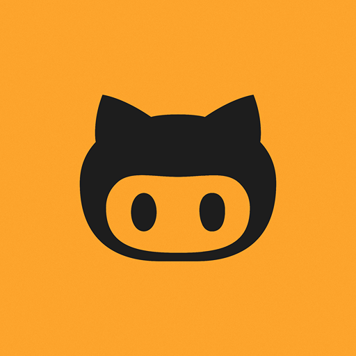
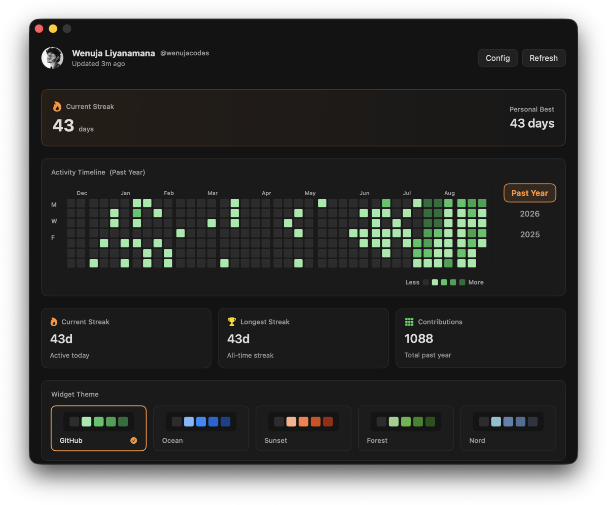
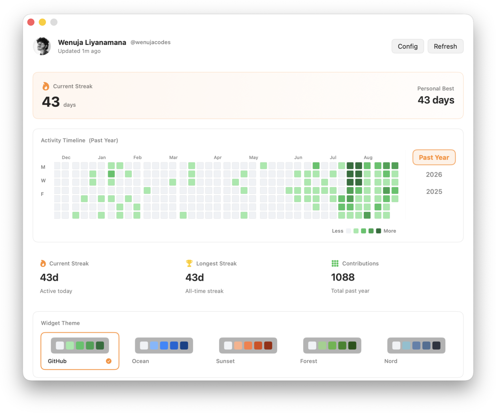
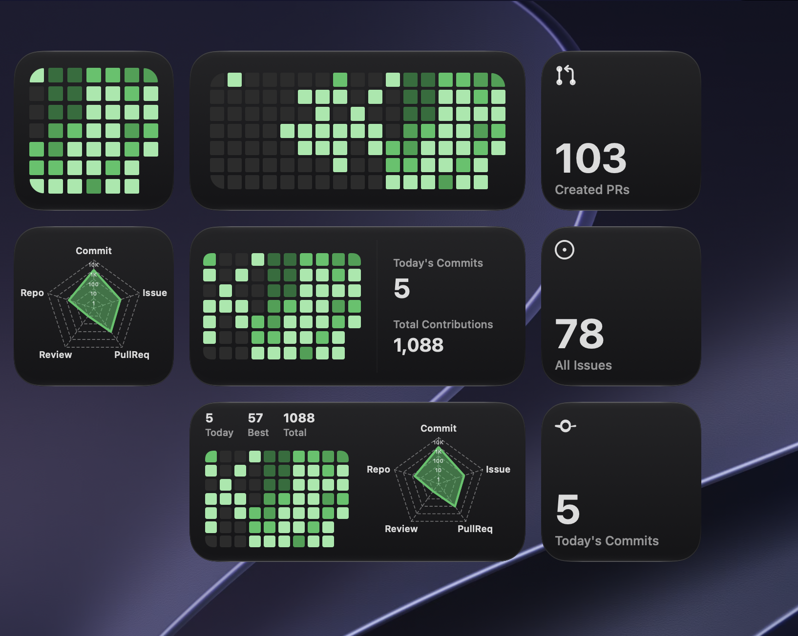
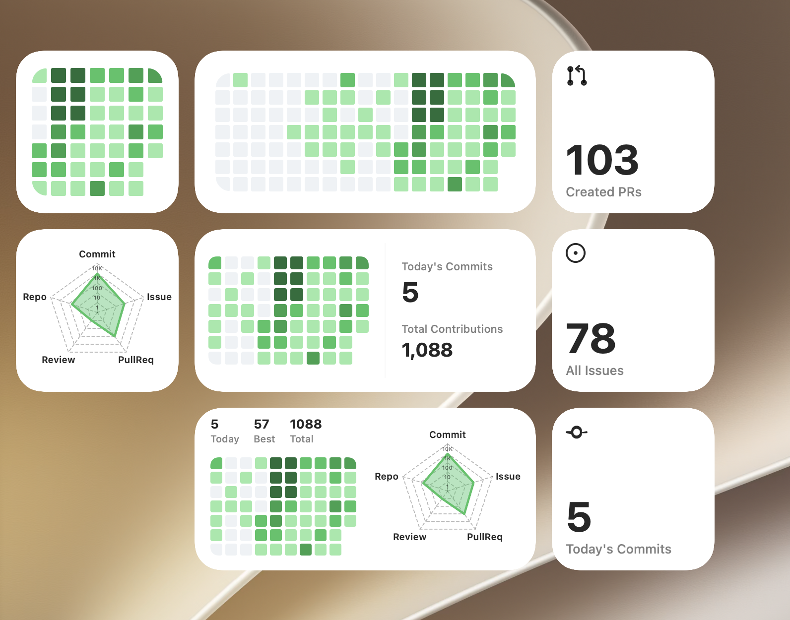

<div align="center">



# GitStreak 

### **Make your coding habit visible on your macOS desktop.**

A native macOS application & WidgetKit engine bringing your GitHub contribution matrix, active streaks, pull requests, and open issues directly to your desktop wallpaper.
<br/>

</div>
<br/>

## 📸 Visual Showcase

### Application
| Dark Mode | Light Mode|
| :---: | :---: |
|  |  |

<br/>

### Widgets
| Dark Mode Widgets | Light Mode Widgets |
| :---: | :---: |
|  |  |

---

## Key Features

### Native Desktop Wallpaper Widgets
* **Pull Requests Widget**: Real-time tracker for PRs created, assigned, mentioned, or review requested.
* **Issues Widget**: Live metrics for open and assigned GitHub issues with custom filters.

### Streak Notifications
* **Streak at Risk**: A reminder at 6 PM (adjustable) if you haven't contributed yet today, with a "Remind Me in 1 Hour" button, plus a last call at 11 PM.
* **Celebrations**: Streak extended, new longest streak, and milestones (7, 30, 50, 100, 365 days and more).
* **Streak Lost & Weekly Recap**: A gentle note the morning after a streak ends, and a Sunday-evening summary of your week.
* Turn each one on or off in **Settings → Notifications**. Only contributions pushed to GitHub count, and GitHub can take a few minutes to show them.

### Customization & Filtering
* **Widget Metrics Filter**: Pick between PR categories (*Created*, *Assigned*, *Mentioned*, *Review Requests*) and Issue categories (*All Open*, *Assigned to Me*).
* **8 Theme Color Palettes**: GitHub, Ocean, Sunset, Forest, Lavender, Rose, Amber and Teal.

### Performance & Security
* **Single GraphQL Call**: Fetches contributions, PRs, and Issues in one GraphQL request every 5 minutes, well within GitHub's rate limit.
* **Smart Local Cache**: Multi-year switching with instant cache-first rendering and a background refresh every 5 minutes.
* **Runs Quietly in the Background**: After you close the window, GitStreak keeps running (no Dock or menu bar icon) so your widgets stay up to date. It launches at login by default.
* **100% Serverless & Private**: Your GitHub token is stored encrypted in the macOS Keychain and is only ever sent to GitHub. Widgets never see it.

---

## 📥 Installation

### Option 1: Direct Download

1. Download the latest release disk image: [**GitStreak-v1.4.3.dmg**](https://github.com/wenujacodes/GitStreak/releases/latest/download/GitStreak-v1.4.3.dmg)
2. Open `GitStreak-v1.4.3.dmg` and **drag `GitStreak.app` into the `Applications` folder shortcut** inside the installer window.
3. Launch **GitStreak** from your `/Applications` folder!

> [!IMPORTANT]
> **macOS Gatekeeper Installation Notes**
> 
> - **Avoid `"Could not install / This Mac could not verify the app"` error**:
>   Do **not** double-click `GitStreak.app` while it is still inside the `.dmg` window. **Drag `GitStreak.app` into `/Applications` first**, then launch it from your `/Applications` folder!
> 
> - **Bypass `"Unidentified Developer"` Prompt (First Launch Only)**:
>   Because GitStreak is distributed open-source via GitHub Releases:
>   1. Open **System Settings** → **Privacy & Security**.
>   2. Scroll down to the **Security** section.
>   3. Click **"Open Anyway"** next to GitStreak.
>   *(Or right-click `GitStreak.app` in `/Applications` → select **Open** → click **Open**).*

### Option 2: Build from Source

```bash
# 1. Clone the repository
git clone https://github.com/wenujacodes/GitStreak.git
cd GitStreak

# 2. Install XcodeGen (if not already installed)
brew install xcodegen

# 3. Generate Xcode project & build
make generate
make build

# 4. Install & Launch GitStreak
make run
```

---

## 🛠️ Desktop Wallpaper Widget Setup

1. Right-click anywhere on your macOS **Desktop Wallpaper**.
2. Click **Edit Widgets...**
3. Search for **GitStreak** in the widget gallery.
4. Drag your preferred widget size (**Small**, **Medium**, **Large**, **PRs**, or **Issues**) onto your desktop!

Widgets update while GitStreak runs in the background. To stop it, open **Settings → Background** and click **Quit GitStreak Completely**, or turn off **Launch at login**.

---

## 🔑 GitHub Token

GitStreak needs a **classic Personal Access Token** with the `repo` and `read:user` scopes. The **Generate Token on GitHub** button in the app opens GitHub with both already selected. Set **Expiration** to *No expiration* if you don't want to renew it.

* **Why `repo`?** GitHub has no read-only token that can see private and organization activity. GitStreak only **reads** your data and never changes anything.
* **Keychain prompt after updates:** after each update, macOS asks once: *"GitStreak wants to access key 'GitStreak GitHub Token' in your keychain."* Enter your Mac password and click **Always Allow**. This happens because GitStreak isn't signed with a paid Apple developer account. If you click **Deny**, open Settings and save your token again.

---

## 💻 Tech Stack

* **Platform Target**: macOS 14.0+ (Sonoma / Sequoia)
* **Language**: Swift 6.0 (Strict Concurrency)
* **Frameworks**: SwiftUI, WidgetKit, Security (Keychain), Sparkle 2.6
* **API**: GitHub GraphQL API v4
* **Tooling**: XcodeGen, XCTest, Make, `create-dmg`
---

## 📄 License

Source-Available under the [Business Source License 1.1 (BSL 1.1)](LICENSE) © 2026 Wenuja Liyanamana. Free for non-commercial personal use and open-source contributions.
